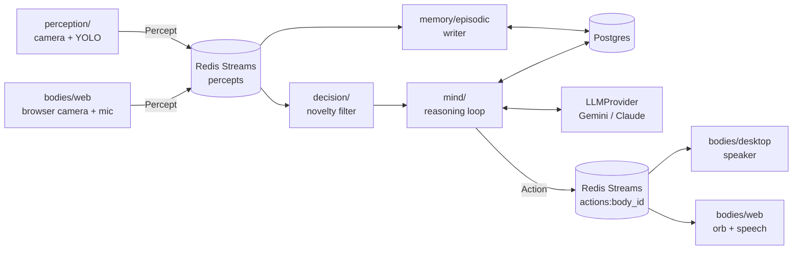

# AURA architecture

AURA is a **body-agnostic core**. The Mind (perception, memory, reasoning, action) never knows which Body it is talking to, so adding a new Body (a browser, a robot) does not mean changing the Mind.

The source of truth for the data shapes is [`contracts/`](../contracts/).

## Data flow

Every arrow between services is a Redis Stream. Services never call each other directly.

## Contracts

Two Pydantic models, defined once, are the only things that cross service boundaries.

- **`Percept`** reports sensory data to the Mind: `source_body_id`, a `type` (object, face, pose, gesture, speech, OCR text, scene change), a `confidence` between 0 and 1, and a loose `payload`. It is frozen (immutable).
- **`Action`** expresses the Mind's intent to a Body: `target_body_id`, an `intent` (speak, express, move toward, manipulate, switch mode), a `priority` (reflex, normal, background) and an optional `requires_ack`. It is also frozen.

The Mind never checks what a Body can actually do with an Action. A desktop Body may ignore `move_toward`; a robot Body would route it to motor controllers through its own adapter.

## Routing

A Body stamps its Percepts with its own `source_body_id`, and the Mind addresses its reply to `actions:<that id>`. A Body called `web-01` therefore gets its own reply stream with no special-casing in Mind or Memory.

Consumers use Redis consumer groups rather than plain pub/sub, so a slow or restarted service picks up where it left off instead of losing messages.

## Components

| Component | Responsibility |
|---|---|
| `perception/` | Camera capture and object detection (YOLOv8n, CPU-first), normalized into Percepts |
| `bus/` | Redis Streams wrapper: publish, consumer groups, blocking consume |
| `memory/episodic/` | Writer persists every Percept to Postgres; store also keeps conversation turns in a separate table, so what was *said* is never confused with what was *seen* |
| `decision/` | Novelty filter: only a label not seen within a cooldown window reaches the Mind, so AURA does not narrate every frame |
| `mind/` | Reasoning loop, persona, query answering from recent memory, greeting generation |
| `mind/llm_provider/` | `LLMProvider` and `TranscriptionProvider` interfaces with Gemini and Claude implementations |
| `bodies/desktop/` | Console and speaker Body, with push-to-talk conversation |
| `bodies/web/` | Browser Body (FastAPI, SSE and MJPEG, plain HTML/JS), with live camera panel and voice |
| `bodies/gate.py` | Interaction policy shared by both Bodies: ambient narration is dropped, not queued, during a conversation, and two sources of speech never overlap |

## Key design decisions

- **Swappable LLM backend.** Nothing in `mind/` imports a vendor SDK. `default_provider()` in `mind/llm_provider/__init__.py` is the single swap point, so a local model can become a third implementation for offline use, for example on a robot with no connectivity. Gemini is the v1 default because it has a free tier and "runs on any computer" rules out a locally hosted model for now.
- **Transcription is a separate interface.** Not every provider handles audio the same way, so forcing `transcribe` into `LLMProvider` would be a leaky abstraction.
- **CPU-first vision.** v1 must run on generic hardware with no dedicated GPU.
- **SSE and MJPEG instead of WebSockets** for the web Body: simpler, and fewer moving parts for a local single-user system.
- **Failures must not kill long-running services.** Both consumer loops guard their database and parse paths so one expected error cannot take a service down (see [`PROJECT_STATE.md`](PROJECT_STATE.md)).

## Roadmap

1. **v1 (current):** vision, episodic memory, speech, browser avatar
2. Activity recognition
3. Advanced reasoning (semantic memory with pgvector, reflex-vs-deliberative arbitration)
4. Continuous learning
5. Physical AI: a robot Body behind the same contracts

Known v1 limits are listed in the [README](../README.md#known-v1-scope-limits-deliberate-not-oversights).
